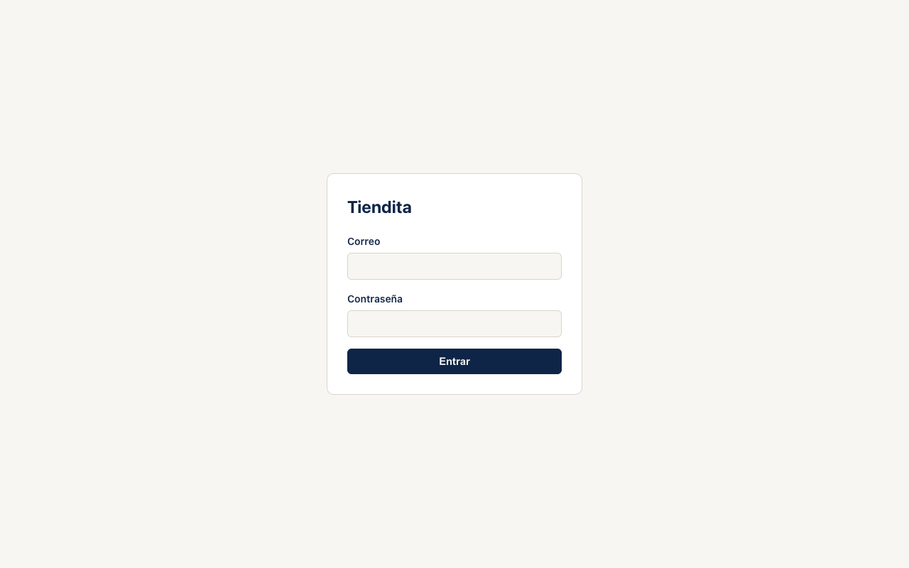
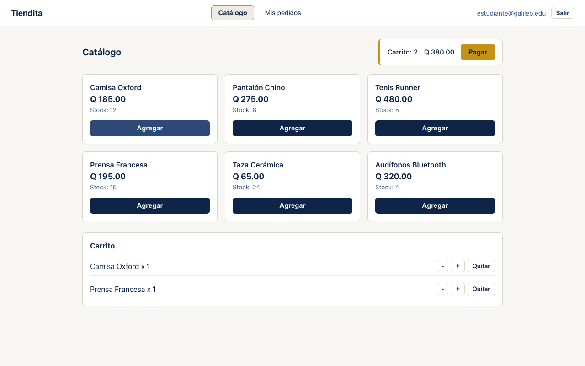
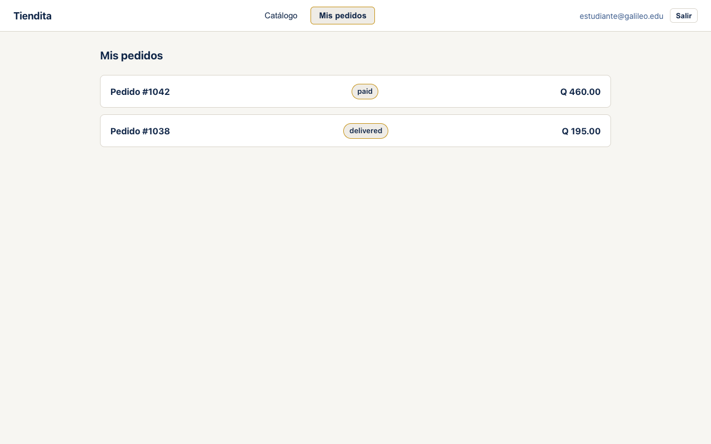

# Tiendita — PDDS Onramp

Los cinco badges arrancan en rojo a propósito. Este repositorio está pensado para ayudarte a preparar tu entrada al Postgrado en Diseño y Desarrollo de Software (PDDS) de Universidad Galileo, pasando cada paso a verde a tu ritmo. Todo gira alrededor de un solo proyecto, **Tiendita**, pero cada uno de los cinco pasos se puede trabajar de forma independiente. Si ya dominas terminal y Git, puedes arrancar directo en el paso 2, el 3 o el que necesites reforzar.

## Los 5 pasos (independientes)

| Paso | Enfoque | Guía |
| --- | --- | --- |
| Paso 1 | Terminal, Git, Pull Requests y flujo de trabajo | [steps/01-terminal-git/README.md](steps/01-terminal-git/README.md) |
| Paso 2 | Reglas de negocio, algoritmos, pruebas y debugging | [steps/02-rules-algorithms/README.md](steps/02-rules-algorithms/README.md) |
| Paso 3 | Modelado relacional, SQL, transacciones y code review | [steps/03-sql/README.md](steps/03-sql/README.md) |
| Paso 4 | Arquitectura por capas, API REST en FastAPI y JWT | [steps/04-api-auth/README.md](steps/04-api-auth/README.md) |
| Paso 5 | React, TypeScript, Neon Auth y deploy en Vercel | [steps/05-react-deploy/README.md](steps/05-react-deploy/README.md) |

## Cómo usar asistentes de IA

Puedes usar asistentes de IA mientras trabajas este onramp, siempre que te ayuden a aprender y no a saltarte el razonamiento.

1. Úsalos para entender mensajes de error, comparar alternativas o destrabarte después de leer `hints/1.md`.
2. Evita aceptar código que no puedas explicar con tus propias palabras.
3. Corre `make self-check STEP=N` y revisa las pruebas contra bugs plantados para comprobar si dominaste cada concepto.

## Inicio rápido

1. Haz clic en **Use this template** en GitHub para crear tu copia del repositorio.
2. Abre la pestaña **Actions** en tu repositorio nuevo y ejecuta el workflow **Initialize Repo** (crea tus issues, abre el PR del paso 3 y actualiza los badges de arriba).
3. Abre el repositorio en **GitHub Codespaces** o clónalo en local con Python 3.12, `uv` y Node 22.
4. Verifica tu entorno con `make doctor` y elige el paso por donde quieras empezar.
5. Revisa tu avance en cualquier momento con `make progress` o valida un paso con `make check STEP=N`.

Si algún término de ingeniería resulta nuevo, consulta el [glosario](docs/glosario.md) y las rúbricas comentadas en [examples/](examples/). Para dudas o compartir avances, usa la pestaña **Discussions** en [ykro/pdds-onramp](https://github.com/ykro/pdds-onramp/discussions).

<!-- SOLUTION_START -->
## Dónde ver la solución de cada problema

Este repositorio contiene las soluciones completas de referencia. Si vienes del [repositorio del problema](https://github.com/ykro/pdds-onramp), aquí encuentras el archivo exacto de cada criterio.

| Paso | Problema y criterio | Archivo de solución |
| --- | --- | --- |
| Paso 1 | Reporte de logs en Bash (`CA-1.1`, `CA-1.2`) | [scripts/log_report.sh](scripts/log_report.sh) |
| Paso 1 | Historia de usuario (`CA-1.3`) | [docs/stories/001-order-history.md](docs/stories/001-order-history.md) |
| Paso 2 | Dinero en centavos, redondeo half-up y cupones (`CA-2.1`) | [backend/tiendita/pricing.py](backend/tiendita/pricing.py) |
| Paso 2 | Máquina de estados y tests contra bugs plantados (`CA-2.2`, `CA-2.3`) | [backend/tiendita/order_status.py](backend/tiendita/order_status.py) y [backend/tests/step2/test_student_order_status.py](backend/tests/step2/test_student_order_status.py) |
| Paso 2 | Búsqueda lineal, binaria y por diccionario (`CA-2.4`) | [backend/tiendita/search.py](backend/tiendita/search.py) |
| Paso 2 | Corrección del bug de búsqueda por nombre (`CA-2.5`) | [backend/tiendita/catalog.py](backend/tiendita/catalog.py) |
| Paso 2 | Árbol recursivo de categorías y cola FIFO (`CA-2.6`, `CA-2.7`) | [backend/tiendita/categories.py](backend/tiendita/categories.py) y [backend/tiendita/fulfillment.py](backend/tiendita/fulfillment.py) |
| Paso 3 | Esquema relacional y constraints (`CA-3.1`) | [db/migrations/001_init.sql](db/migrations/001_init.sql) |
| Paso 3 | Consultas SQL de ventas, top productos y stock bajo (`CA-3.2`) | [db/queries/monthly_sales.sql](db/queries/monthly_sales.sql), [db/queries/top_products.sql](db/queries/top_products.sql) y [db/queries/low_stock.sql](db/queries/low_stock.sql) |
| Paso 3 | Transacción con `SELECT ... FOR UPDATE` y corrección del code review (`CA-3.3`, `CA-3.4`) | [backend/tiendita/repositories/orders_repo.py](backend/tiendita/repositories/orders_repo.py) y [backend/tests/step3/test_student_review.py](backend/tests/step3/test_student_review.py) |
| Paso 3 | Índice de rendimiento (`CA-3.6`) | [db/migrations/003_indexes.sql](db/migrations/003_indexes.sql) |
| Paso 4 | Migración de roles e idempotencia (`CA-4.1`) | [db/migrations/002_roles_and_idempotency.sql](db/migrations/002_roles_and_idempotency.sql) |
| Paso 4 | API en capas, verificación JWT/JWKS, autorización, rol admin e idempotencia (`CA-4.2` a `CA-4.8`) | [backend/tiendita/api/app.py](backend/tiendita/api/app.py), [backend/tiendita/api/auth.py](backend/tiendita/api/auth.py) y [backend/tiendita/services/store_service.py](backend/tiendita/services/store_service.py) |
| Paso 4 | ADR de autenticación (`CA-4.5`) | [docs/decisions/0001-auth.md](docs/decisions/0001-auth.md) |
| Paso 5 | Hook del carrito, vistas en React, cliente HTTP y deploy (`CA-5.1` a `CA-5.4`) | [frontend/src/hooks/useCart.ts](frontend/src/hooks/useCart.ts), [frontend/src/lib/api.ts](frontend/src/lib/api.ts), [frontend/src/lib/auth.ts](frontend/src/lib/auth.ts) y [vercel.json](vercel.json) |

## Cómo debería verse Tiendita

Inicio de sesión

Catálogo y carrito

Mis pedidos

<!-- SOLUTION_REPLACE -->
Si quieres comparar tu trabajo, ver las capturas de pantalla de cómo debería verse la aplicación o revisar los archivos de solución por problema, consulta el [repositorio de soluciones de referencia](https://github.com/ykro/pdds-onramp-solutions).
<!-- SOLUTION_END -->

## Licencia

Publicado bajo licencia [MIT](LICENSE).
