# Paso 1. Terminal, Git y flujo de trabajo

## Antes de empezar

1. ¿Para qué sirve el código de salida (`exit code`) de un script en la terminal cuando forma parte de un pipeline de automatización? (Pista, revisa `scripts/log_report.sh` y `example/intro-terminal.md`.)
2. ¿Por qué conviene separar un cambio en una rama nueva y abrir un Pull Request en lugar de empujar commits directo a `main`? (Pista, revisa `diagrams/git-flow.svg` y `examples/code-review.md`.)
3. ¿Qué diferencia a una historia de usuario verificable de una petición ambigua cuando un equipo planea un cambio? (Pista, revisa `docs/stories/001-order-history.md`.)

## Por qué importa

Quien lidera equipos técnicos necesita leer scripts de operación en minutos, detectar dónde fallan y revisar cambios con criterio en un Pull Request. Dominar la línea de comandos como propone [MIT The Missing Semester](https://missing.csail.mit.edu/) y manejar ramas limpias según [Pro Git](https://git-scm.com/book/en/v2) te da control sobre cualquier repositorio. Además, los hábitos de automatización y pruebas repetibles de *The Pragmatic Programmer* (Thomas y Hunt) convierten tareas manuales frágiles en herramientas confiables.

## Qué vas a hacer

- **Leer**. Inspecciona `scripts/log_report.sh` y las primeras líneas de `data/access.log` para entender el formato de columnas y cómo se encadenan `wc`, `awk`, `sort` y `uniq`. Si quieres repasar comandos básicos del shell, abre [example/intro-terminal.md](example/intro-terminal.md).
- **Debuguear**. Crea una rama nueva y corrige dos fallas en `scripts/log_report.sh`, porque el script sigue sin salir con código `1` cuando falta el archivo de entrada y cuenta códigos `4xx` en lugar de errores `5xx`.
- **Escribir**. Completa la historia de usuario en `docs/stories/001-order-history.md` usando el formato Como / Quiero / Para y al menos dos criterios Dado / Cuando / Entonces. Luego abre tu Pull Request y contrasta tu trabajo contra la guía de [examples/code-review.md](../../examples/code-review.md).

## Criterios de aceptación

- `CA-1.1` `scripts/log_report.sh` tiene permiso de ejecución (`+x`), sale con código `1` si falta el archivo y sale con código `0` cuando el archivo existe.
- `CA-1.2` `scripts/log_report.sh data/access.log` imprime `total_requests`, `errors_5xx` y `top_endpoints` con los conteos exactos del log.
- `CA-1.3` `docs/stories/001-order-history.md` cumple la estructura Como / Quiero / Para e incluye al menos dos criterios con Dado / Cuando / Entonces.

## Al terminar

1. ¿Para qué sirve el código de salida (`exit code`) de un script en la terminal cuando forma parte de un pipeline de automatización? (Pista, revisa `scripts/log_report.sh` y `example/intro-terminal.md`.)
2. ¿Por qué conviene separar un cambio en una rama nueva y abrir un Pull Request en lugar de empujar commits directo a `main`? (Pista, revisa `diagrams/git-flow.svg` y `examples/code-review.md`.)
3. ¿Qué diferencia a una historia de usuario verificable de una petición ambigua cuando un equipo planea un cambio? (Pista, revisa `docs/stories/001-order-history.md`.)

## Cómo verificar

Ejecuta `make check STEP=1` desde la raíz del repositorio para validar los tres criterios en automático. Si te trabas, revisa los ejemplos en [example/intro-terminal.md](example/intro-terminal.md) y [example/sample_report.sh](example/sample_report.sh), o abre la [primera pista](hints/1.md).

## Respuestas de autoevaluación

1. El código de salida comunica al sistema operativo y a otros scripts si el comando terminó bien (`0`) o falló (un número distinto de `0`, como `1`). Un pipeline de CI o un cron detiene la ejecución y dispara alertas cuando recibe un código distinto de cero, evitando procesar reportes vacíos o corruptos.
2. Trabajar en una rama aísla el cambio hasta que pase las pruebas y reciba revisión de otro ingeniero. El Pull Request deja registro del contexto, facilita revertir un cambio específico si rompe producción y reduce el riesgo de dañar `main`.
3. Una historia verificable nombra quién recibe el valor, qué necesita y por qué importa (Como / Quiero / Para), y traduce ese objetivo en escenarios observables (Dado / Cuando / Entonces). Así ingeniería, producto y QA acuerdan qué significa terminar antes de escribir código.
