# Paso 1. Terminal, Git y flujo de trabajo

## Por qué importa

Todo equipo de ingeniería colabora sobre un historial compartido y reproduce su entorno desde la línea de comandos. Dominar el shell como plantea [MIT Missing Semester](https://missing.csail.mit.edu/) y gestionar ramas con [Pro Git](https://git-scm.com/book/en/v2) evita pérdida de código y hace auditable cada cambio. Si necesitas repasar rutas, variables de entorno y pipelines antes de empezar, revisa la [guía opcional de terminal](example/intro-terminal.md) y el [glosario](../../docs/glosario.md).

## Qué se construye

**Núcleo**
- El script `scripts/log_report.sh` que procesa `data/access.log`, imprime `total_requests=`, `errors_5xx=` y `top_endpoints=`, y sale con código `1` cuando falta el archivo, aplicando hábitos de automatización de *The Pragmatic Programmer* (Hunt y Thomas).
- La historia de usuario en `docs/stories/001-order-history.md` con formato Como/Quiero/Para y al menos dos criterios Dado/Cuando/Entonces.
- Un Pull Request completo que cierra un issue enlazado siguiendo [GitHub Docs](https://docs.github.com/en/pull-requests).

**Extendido**
- Un postmortem breve en `docs/postmortems/001-log-incident.md` que explica el incidente detectado en el log.

## Criterios de aceptación

- `CA-1.1` [auto, núcleo] `scripts/log_report.sh` tiene permiso `+x` y sale con código `1` si el archivo no existe.
- `CA-1.2` [auto, núcleo] `scripts/log_report.sh data/access.log` reporta `total_requests`, `errors_5xx` y `top_endpoints`.
- `CA-1.3` [auto, núcleo] `docs/stories/001-order-history.md` incluye formato Como/Quiero/Para y al menos dos criterios Dado/Cuando/Entonces.
- `CA-1.4` [rubric, núcleo] La historia de usuario y el PR cumplen `examples/historia-y-pr.md`.
- `CA-1.5` [rubric, extendido] `docs/postmortems/001-log-incident.md` explica el incidente del log según `examples/postmortem.md`.

## Cómo verificar

Ejecuta las pruebas del núcleo con `make check STEP=1` y agrega los criterios extendidos con `make check STEP=1 EXTRA=1`. Responde la autoevaluación formativa con `make self-check STEP=1`, o omite la sección básica con `make self-check STEP=1 ARGS="--skip-intro"`. Si necesitas apoyo, revisa la [guía opcional de terminal](example/intro-terminal.md) o abre la [primera pista](hints/1.md).
