# Paso 2. Reglas de negocio y algoritmos

## Por qué importa

El dinero calculado con punto flotante acumula errores de redondeo que arruinan facturas y cierres de caja. Modelar precios en centavos enteros, elegir estructuras eficientes como enseña [Runestone Python DS](https://runestone.academy/ns/books/published/pythonds3/index.html) junto con *Grokking Algorithms* (Bhargava), y blindar cada regla con pruebas automatizadas garantiza resultados exactos antes de tocar una base de datos.

## Qué se construye

**Núcleo**
- `pricing.py` en Python puro con centavos en `int`, `round_half_up_percent` y `calculate_order_total` con cupones y tope, siguiendo *A Philosophy of Software Design* (Ousterhout).
- `order_status.py` y tus pruebas en `backend/tests/step2/test_student_order_status.py` con [pytest](https://docs.pytest.org/) bajo el enfoque de [Test-Driven Development with Python](https://www.obeythetestinggoat.com/) para detectar tres versiones con bugs plantados.
- `search.py` comparando búsqueda lineal, binaria y por diccionario mediante `make bench`, más hacer debugging del bug de tildes y espacios en `catalog.py` (`search_by_name`).

**Extendido**
- `categories.py` para recorrer un árbol recursivo de categorías y `fulfillment.py` con una cola FIFO sobre `collections.deque`.

## Criterios de aceptación

- `CA-2.1` [auto, núcleo] `pricing.py` opera en centavos `int`, aplica `round_half_up_percent`, calcula cupones con tope en `calculate_order_total` y lanza `OutOfStockError` si falta inventario.
- `CA-2.2` [auto, núcleo] `order_status.py` valida las transiciones permitidas de un pedido y rechaza las inválidas con `InvalidTransitionError`.
- `CA-2.3` [auto, núcleo] `backend/tests/step2/test_student_order_status.py` detecta con `AssertionError` las tres versiones con bugs plantados en la máquina de estados.
- `CA-2.4` [auto, núcleo] `search.py` implementa búsqueda lineal `O(n)`, binaria `O(log n)` y por diccionario `O(1)` respetando sus cotas de operaciones y `make bench`.
- `CA-2.5` [auto, núcleo] `catalog.py` carga las 40 filas válidas y 5 inválidas de `data/products.csv` y corrige el bug de tildes, mayúsculas y espacios en `search_by_name`.
- `CA-2.6` [auto, extendido] `categories.py` cuenta los productos de un árbol de categorías con `count_products_in_tree` de forma recursiva.
- `CA-2.7` [auto, extendido] `fulfillment.py` despacha pedidos en orden FIFO mediante `FulfillmentQueue` con `deque`.

## Cómo verificar

Corre el núcleo con `make check STEP=2`, las pruebas extendidas con `make check STEP=2 EXTRA=1` y la medición de búsquedas con `make bench`. Ejecuta la autoevaluación formativa con `make self-check STEP=2`. Consulta [example/discount_example.py](example/discount_example.py) o empieza por la [primera pista](hints/1.md).
