# Paso 2. Reglas de negocio y algoritmos

## Antes de empezar

1. ¿Por qué calcular precios con números de punto flotante (`float`) genera errores silenciosos en una tienda en línea? (Pista, revisa `backend/tiendita/pricing.py` y `example/discount_example.py`.)
2. ¿Cómo cambia el tiempo de respuesta de una búsqueda lineal frente a un diccionario cuando el catálogo crece de 1,000 a 100,000 productos? (Pista, ejecuta `make bench` y lee `backend/tiendita/search.py`.)
3. ¿Qué ventaja da escribir pruebas automatizadas sobre casos borde de negocio antes de tocar una base de datos o un servidor web? (Pista, revisa `backend/tests/step2/test_student_pricing.py`.)

## Por qué importa

Los bugs más caros en producción suelen vivir en reglas de negocio pequeñas y en estructuras de datos mal elegidas para el tamaño real del sistema. Comprender complejidad algorítmica como explican [Problem Solving with Algorithms and Data Structures using Python](https://runestone.academy/ns/books/published/pythonds3/index.html) y *Grokking Algorithms* (Bhargava) te ayuda a evaluar decisiones de rendimiento con datos medidos. A la vez, mantener módulos simples como plantea *A Philosophy of Software Design* (Ousterhout) y validarlos con [pytest](https://docs.pytest.org/) permite cambiar reglas sin romper cálculos existentes.

## Qué vas a hacer

- **Leer**. Corre `make bench` y lee `scripts/bench_search.py` junto con `backend/tiendita/search.py` para observar cómo escala una búsqueda lineal frente a un diccionario al pasar de 1,000 a 100,000 productos.
- **Debuguear**. Corrige dos bugs en código existente, primero en `backend/tiendita/pricing.py` (donde se usa `float` y se omite el tope `max_discount_cents`) y después en `backend/tiendita/catalog.py` (donde `search_by_name` falla ante tildes, mayúsculas y espacios repetidos).
- **Escribir**. Agrega al menos tres pruebas reales en `backend/tests/step2/test_student_pricing.py` para cubrir redondeo half-up, tope de cupón y `OutOfStockError`.

## Criterios de aceptación

- `CA-2.1` `backend/tiendita/pricing.py` calcula centavos exactos con `int`, aplica redondeo half-up, respeta `max_discount_cents` y lanza `OutOfStockError` cuando falta inventario.
- `CA-2.2` `backend/tiendita/catalog.py` carga `data/products.csv` y encuentra `"  pantalón   chino "` mediante `search_by_name`.
- `CA-2.3` `backend/tests/step2/test_student_pricing.py` contiene al menos tres funciones de prueba reales que pasan en `pytest`.

## Al terminar

1. ¿Por qué calcular precios con números de punto flotante (`float`) genera errores silenciosos en una tienda en línea? (Pista, revisa `backend/tiendita/pricing.py` y `example/discount_example.py`.)
2. ¿Cómo cambia el tiempo de respuesta de una búsqueda lineal frente a un diccionario cuando el catálogo crece de 1,000 a 100,000 productos? (Pista, ejecuta `make bench` y lee `backend/tiendita/search.py`.)
3. ¿Qué ventaja da escribir pruebas automatizadas sobre casos borde de negocio antes de tocar una base de datos o un servidor web? (Pista, revisa `backend/tests/step2/test_student_pricing.py`.)

## Cómo verificar

Ejecuta `make check STEP=2` para validar los tres criterios y corre `make bench` para medir las búsquedas. Si necesitas una referencia rápida, revisa [example/discount_example.py](example/discount_example.py) o abre la [primera pista](hints/1.md).

## Respuestas de autoevaluación

1. El estándar binario IEEE 754 representa fracciones decimales como `0.1` con aproximaciones, y esas diferencias se acumulan en descuentos, impuestos y sumas de carrito. Operar en centavos enteros (`int`) con redondeo explícito mantiene exactitud total en cada transacción.
2. En una búsqueda lineal (`O(n)`), multiplicar por 100 el catálogo multiplica cerca de 100 veces el número de comparaciones. En un diccionario (`O(1)`), el tiempo de búsqueda permanece casi constante aunque el catálogo tenga cien veces más productos.
3. Probar funciones puras en aislamiento corre en milisegundos, reproduce casos límite exactos (como redondeos en `.5`, topes de cupón y falta de stock) y detecta regresiones de inmediato sin depender de red ni contenedores.
