# Paso 3. SQL, modelado y concurrencia

## Por qué importa

Una tienda real guarda pedidos en disco y atiende a varios compradores al mismo tiempo. Entender esquemas relacionales e índices como enseña [CMU 15-445](https://15445.courses.cs.cmu.edu/) junto con [Use The Index, Luke](https://use-the-index-luke.com/), y controlar transacciones como explica el capítulo 7 de *Designing Data-Intensive Applications* (Kleppmann), impide vender dos veces la última unidad en stock.

## Qué se construye

**Núcleo**
- La migración `db/migrations/001_init.sql` con `products`, `orders` y `order_items`, más las consultas `db/queries/monthly_sales.sql`, `top_products.sql` y `low_stock.sql` sobre PostgreSQL levantado con `make db-up`.
- `orders_repo.place_order()` usando `SELECT ... FOR UPDATE` según la [documentación de PostgreSQL](https://www.postgresql.org/docs/current/explicit-locking.html) para evitar race conditions de inventario.
- El code review del PR `review/step-3-orders-by-sku`, corrigiendo `orders_repo.find_orders_by_sku()` y escribiendo `backend/tests/step3/test_student_review.py` contra `steps/03-sql/buggy_snapshot.py`.

**Extendido**
- La migración `db/migrations/003_indexes.sql` con `idx_order_items_product_id` y un postmortem del incidente de concurrencia.

## Criterios de aceptación

- `CA-3.1` [auto, núcleo] `db/migrations/001_init.sql` crea `products`, `orders` y `order_items` con restricciones `NOT NULL`, `UNIQUE`, llaves foráneas y `CHECK` que rechazan stock negativo.
- `CA-3.2` [auto, núcleo] `db/queries/monthly_sales.sql`, `top_products.sql` y `low_stock.sql` devuelven las ventas mensuales, los 5 productos más vendidos y los productos con stock menor o igual a 5.
- `CA-3.3` [auto, núcleo] `orders_repo.place_order()` usa `SELECT ... FOR UPDATE` para que ante 10 compras simultáneas sobre la última unidad en stock exista exactamente una venta.
- `CA-3.4` [auto, núcleo] `orders_repo.find_orders_by_sku()` corrige la inyección SQL y excluye pedidos cancelados, y `test_student_review.py` detecta ambas fallas con `AssertionError` contra `steps/03-sql/buggy_snapshot.py`.
- `CA-3.5` [rubric, núcleo] La revisión del PR `review/step-3-orders-by-sku` cumple `examples/code-review.md`.
- `CA-3.6` [auto, extendido] `db/migrations/003_indexes.sql` crea `idx_order_items_product_id` sobre `order_items`.
- `CA-3.7` [rubric, extendido] El postmortem del incidente de concurrencia cumple `examples/postmortem.md`.

## Cómo verificar

Levanta PostgreSQL local con `make db-up`, ejecuta `make check STEP=3` para el núcleo y `make check STEP=3 EXTRA=1` para los criterios extendidos. Practica con `make self-check STEP=3`. Antes de escribir tus consultas, revisa [example/guided_joins_and_groupby.sql](example/guided_joins_and_groupby.sql) o consulta la [primera pista](hints/1.md).
