# Paso 4. API REST, capas y autorización

Este paso toma unos 60 minutos.

## Antes de empezar

1. Si la regla «cada quien ve solo sus pedidos» vive mezclada con el código HTTP, ¿cómo la pruebas sin levantar un servidor?
2. ¿Qué diferencia existe entre autenticar quién envió un token JWT y autorizar qué recursos puede consultar esa persona?
3. Pides un producto con un código que no existe. ¿Qué debería responder el API, una lista vacía, un error u otra cosa?

## Por qué importa

En el posgrado diseñarás APIs por capas y revisarás quién puede ver qué datos. Si confundes autenticar con autorizar, publicas un endpoint que muestra los pedidos de otros clientes.

## Lo mínimo que necesitas saber

- **API REST.** El cliente pide un recurso con un método y una ruta (`GET /api/products/SKU-001`) y el servidor responde con un código y JSON. `200` es éxito, `401` es «no sé quién eres», `403` es «sé quién eres pero no puedes» y `404` es «no existe».
- **Tres capas.** La ruta (`app.py`) solo traduce HTTP: lee parámetros y devuelve códigos. El servicio (`store_service.py`) aplica las reglas del negocio, como «cada quien ve solo sus pedidos». El repositorio (`orders_repo.py`) habla con la base de datos. Cada capa se puede leer y probar por separado.
- **Inyección de dependencias.** Una ruta no crea su servicio; lo declara con `Depends(get_store_service)` y FastAPI se lo entrega en cada request. Los tests del paso usan esa puerta: `app.dependency_overrides[get_store_service]` cambia el servicio por uno con un repositorio falso en memoria, sin base de datos. Es la misma idea que pasar un objeto por el constructor en lugar de crearlo adentro.
- **Autenticar y autorizar.** Autenticar es comprobar quién manda el request (el token JWT es válido y no venció). Autorizar es decidir qué puede ver esa persona. Un token válido no da permiso para leer los datos de otro.
- **JWT.** Un token con tres partes separadas por punto. El contenido se puede leer sin clave; la firma permite detectar si alguien lo cambió. El API verifica la firma con las llaves públicas que publica el servidor de autenticación (JWKS).

## Qué vas a hacer

- **Leer**. `make check STEP=4` no necesita base de datos. Recorre las tres capas en `backend/tiendita/api/app.py`, `backend/tiendita/services/store_service.py` y `backend/tiendita/repositories/orders_repo.py`, y la verificación JWT ya lista en `backend/tiendita/api/auth.py`. Opcional: con Docker abierto, corre `make db-up`, `make migrate` y `make dev-api`, y prueba `GET /api/products` en `http://localhost:8000/docs`.
- **Debuguear**. Corrige la fuga de autorización en `StoreService.get_my_orders()` dentro de `backend/tiendita/services/store_service.py`, donde un usuario autenticado puede leer pedidos que pertenecen a otra cuenta.
- **Escribir**. Agrega el endpoint `GET /api/products/{sku}`. El repositorio ya tiene `get_product_by_sku` en `orders_repo.py`; te toca escribir el método del servicio en `store_service.py` y la ruta en `app.py`, que responde `200` con el producto o `404` cuando el SKU no existe. Al final escribe el ADR de `CA-4.4`.

## Criterios de aceptación

- `CA-4.1` `GET /api/orders/mine` exige un token JWT válido (`401` si falta) y devuelve únicamente los pedidos del usuario autenticado.
- `CA-4.2` `GET /api/products/{sku}` atraviesa las tres capas y responde `200` cuando el SKU existe o `404` cuando falta.
- `CA-4.3` `StoreService.get_product` devuelve el producto y lanza `KeyError` cuando el SKU no existe, sin pasar por HTTP.
- `CA-4.4` `docs/adr/0001-<tema>.md` explica por qué la autorización vive en el servicio, con cuatro encabezados: contexto, decisión, alternativas descartadas y consecuencias. Usa [examples/adr.md](../../examples/adr.md) como modelo. El check solo revisa los encabezados; el contenido lo comparas tú con ese modelo.

## Al terminar

1. `list_orders_for_user` ya filtra por `user_id` en el SQL. ¿Por qué conviene filtrar otra vez en el servicio?
2. Ana pide `GET /api/orders/mine`. ¿Qué responde el API si su token venció hace un minuto, y qué responde si el token es válido pero Ana todavía no tiene pedidos?
3. Explica en tres líneas, con tus palabras, qué cambiaste y por qué. Si no puedes, vuelve a la pista 1 antes de seguir.

## Cómo verificar

Ejecuta `make check STEP=4` para validar los cuatro criterios en local usando el servidor JWKS de prueba. Si quieres ver el patrón completo antes de editar, revisa [example/layered_endpoint_example.py](example/layered_endpoint_example.py) o abre la [primera pista](hints/1.md).

## Respuestas de autoevaluación

### Antes de empezar

1. No podrías probarla como función normal: tendrías que simular requests HTTP, encabezados y tokens en cada prueba en lugar de pasarle un usuario y una lista en memoria al servicio.
2. Autenticar confirma quién es la persona que envía el request; autorizar verifica si esa persona tiene permiso para ver o modificar el recurso pedido.
3. Debe responder un error `404 Not Found`, porque se pidió un recurso puntual que no existe (una lista vacía `200` solo aplica al listar una colección sin resultados).

### Al terminar

1. Porque la regla de autorización vive en el servicio. Si mañana alguien cambia el repositorio o lo reemplaza por otro, el servicio sigue garantizando que nadie lee pedidos ajenos, y esa regla se puede testear sin base de datos.
2. Con el token vencido responde `401 Unauthorized`. Con un token válido y sin pedidos responde `200 OK` con una lista vacía, porque la petición es correcta aunque no haya datos.
3. Respuesta personal. Debe distinguir autenticación de autorización y describir el recorrido del endpoint por las tres capas.
