# Paso 4. API REST, capas y autenticación

## Por qué importa

El backend expone las reglas de negocio sobre HTTP sin mezclar rutas, lógica y SQL en un mismo archivo. Separar capas como propone [Cosmic Python](https://www.cosmicpython.com/book/preface.html) y *Fundamentals of Software Architecture* (Richards y Ford), respetar la semántica de [MDN HTTP](https://developer.mozilla.org/en-US/docs/Web/HTTP) y validar tokens con [RFC 8725](https://datatracker.ietf.org/doc/html/rfc8725) protege los pedidos y simplifica cada prueba.

## Qué se construye

**Núcleo**
- El API en [FastAPI](https://fastapi.tiangolo.com/) dividido en rutas, servicios y repositorios conectados mediante inyección de dependencias.
- Verificación de JWT mediante JWKS con caché, control de acceso por propietario y configuración externa según [The Twelve-Factor App](https://12factor.net/).
- Un registro de decisión arquitectónica (ADR) en `docs/decisions/0001-auth.md` que justifica la estrategia de autenticación.

**Extendido**
- Soporte de `Idempotency-Key` en creación de órdenes siguiendo el patrón de [Stripe Idempotency](https://stripe.com/blog/idempotency).
- Paginación por cursor en historial de órdenes y manejo uniforme de errores con `application/problem+json`.

## Criterios de aceptación

- `CA-4.1` [auto, núcleo] Las rutas de catálogo, carrito y órdenes responden con los códigos HTTP y esquemas Pydantic definidos en el contrato.
- `CA-4.2` [auto, núcleo] La capa de servicios se prueba en aislamiento usando repositorios en memoria sin levantar PostgreSQL.
- `CA-4.3` [auto, núcleo] Los endpoints protegidos rechazan tokens ausentes, expirados o mal firmados con `401` y bloquean acceso a órdenes ajenas con `403`.
- `CA-4.4` [auto, núcleo] Toda configuración sensible llega por variables de entorno y el endpoint `/health` verifica conectividad real con la base de datos.
- `CA-4.5` [rubric, núcleo] El documento `docs/decisions/0001-auth.md` cumple la rúbrica de `examples/adr.md` con contexto, decisión y consecuencias concretas.
- `CA-4.6` [auto, extendido] Reenviar un `POST /orders` con la misma `Idempotency-Key` devuelve la orden original sin cobrar ni descontar stock dos veces.
- `CA-4.7` [auto, extendido] El historial soporta paginación estable por cursor sin duplicados ni saltos al insertar nuevas órdenes.
- `CA-4.8` [auto, extendido] Los errores de negocio y validación devuelven respuestas estructuradas consistentes con tipo, título y detalle.

## Cómo verificar

Corre `make check STEP=4` para validar el núcleo y `make check STEP=4 EXTRA=1` para el alcance extendido. Ejecuta `make self-check STEP=4` para las preguntas de autoevaluación formativa. Revisa el patrón completo en [example/layered_endpoint_example.py](example/layered_endpoint_example.py) o abre la [primera pista](hints/1.md).
