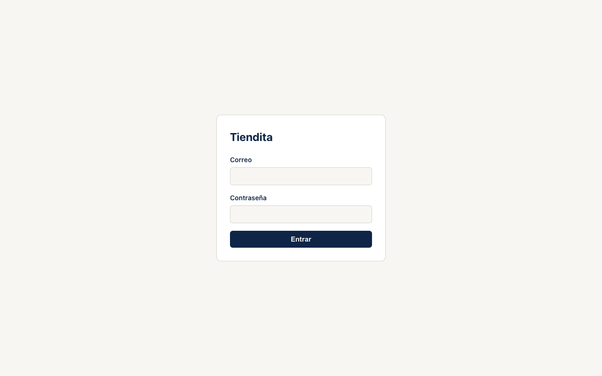

# Paso 5. React, TypeScript y deploy en producción

Este paso toma unos 60 (más unos 45 si haces el deploy opcional) minutos.

## Antes de empezar

1. ¿Qué ventajas da tipar las respuestas del backend en TypeScript antes de renderizarlas en una vista de React? (Pista, revisa `example/python_vs_typescript.md` y `frontend/src/lib/api.ts`.)
2. ¿Por qué conviene derivar totales como `totalCents` desde la lista de ítems del carrito en lugar de guardar un segundo estado manual? (Pista, revisa `frontend/src/hooks/useCart.ts`.)
3. ¿Qué valida un smoke test sobre producción que las pruebas unitarias locales dejan fuera? (Pista, revisa `diagrams/deployment.svg` y `backend/tests/step5/test_prod_deploy.py`.)

## Por qué importa

El valor técnico se comprueba cuando el frontend tipado conversa con el API real, autentica usuarios y responde estable en producción. Comprender el flujo de datos declarativo de [Thinking in React](https://react.dev/learn/thinking-in-react) y [Full Stack Open](https://fullstackopen.com/en/), apoyado en el [TypeScript Handbook](https://www.typescriptlang.org/docs/handbook/intro.html) y *Effective TypeScript* (Vanderkam), te da criterio para diagnosticar fallas de punta a punta desde el navegador hasta la nube.

## Qué vas a hacer

- **Leer**. Revisa [example/python_vs_typescript.md](example/python_vs_typescript.md) si vienes de Python, y luego inspecciona `frontend/src/lib/api.ts`, `frontend/src/lib/auth.ts` y `frontend/src/views/CatalogView.tsx` para seguir cómo el navegador autentica sesiones y llama al backend.
- **Debuguear**. Levanta el frontend con `make dev-web`, agrega tres unidades del mismo producto al carrito y compara el total con la cuenta a mano. Encuentra en `frontend/src/hooks/useCart.ts` por qué no coinciden.
- **Escribir**. Tiendita regala el envío desde `FREE_SHIPPING_CENTS` (Q 300.00). Completa `freeShippingRemainingCents` en `useCart.ts` y escribe el componente `frontend/src/views/FreeShippingNotice.tsx`, que avisa cuánto falta o que el envío ya es gratis. Después muéstralo en la barra del carrito de `CatalogView.tsx`, junto al total.
- **Reto opcional: deploy**. Conecta tu copia a Neon y [Neon Auth](https://neon.com/docs/guides/neon-auth), haz deploy del proyecto completo en [Vercel](https://vercel.com/docs/functions/runtimes/python) y registra tu URL pública en `app_url` dentro de `deploy.json`. El badge del paso no depende de esto; hazlo cuando tengas tiempo para crear las tres cuentas.

## Referencia visual

Así se ven las tres vistas cuando la aplicación está lista.

## Criterios de aceptación

- `CA-5.1` `frontend/` pasa `npm run typecheck` y `npm run build` sin errores.
- `CA-5.2` `useCart` y las tres vistas principales pasan la suite de pruebas en `vitest`.
- `CA-5.3` `freeShippingRemainingCents` nunca es negativo y `FreeShippingNotice` anuncia con `role="status"` cuánto falta o que el envío es gratis.
- Opcional: `deploy.json` apunta a tu URL de Vercel y `make check-prod` confirma `/api/health`, `/api/products`, `/api/orders/mine` y `/`.

## Al terminar

1. Si guardaras `totalCents` en un `useState` aparte, ¿qué pasaría al quitar un producto del carrito y olvidar actualizarlo?
2. Tu deploy en Vercel responde `200` en `/api/health`, pero el login falla. ¿Qué revisas primero?
3. `npm test` pasa en local y `make check-prod` falla. ¿Qué tipo de problema indica eso?
4. Explica en tres líneas, con tus palabras, qué cambiaste y por qué. Si no puedes, vuelve a la pista 1 antes de seguir.

## Cómo verificar

Ejecuta `make check STEP=5` para validar el frontend y las pruebas en local, y corre `make check-prod` cuando tu app esté desplegada en Vercel. Revisa [example/python_vs_typescript.md](example/python_vs_typescript.md) o empieza por la [primera pista](hints/1.md).

## Respuestas de autoevaluación

1. El total mostraría el monto viejo y el carrito quedaría inconsistente. Al derivarlo de `items` con `useMemo`, el total siempre corresponde a lo que hay en el carrito.
2. Las variables de entorno de Production (`NEON_AUTH_JWKS_URL` y `VITE_NEON_AUTH_URL`) y que tu dominio de Vercel esté en Trusted Domains de Neon Auth. El health check no usa autenticación, por eso responde bien.
3. Un problema de configuración o de entorno (variables, URL de la base de datos, migraciones sin aplicar o dominio), no de lógica, porque el mismo código ya pasó sus tests.
4. Respuesta personal. Debe mencionar el total derivado de cantidad por precio y lo que valida el smoke test en producción.
