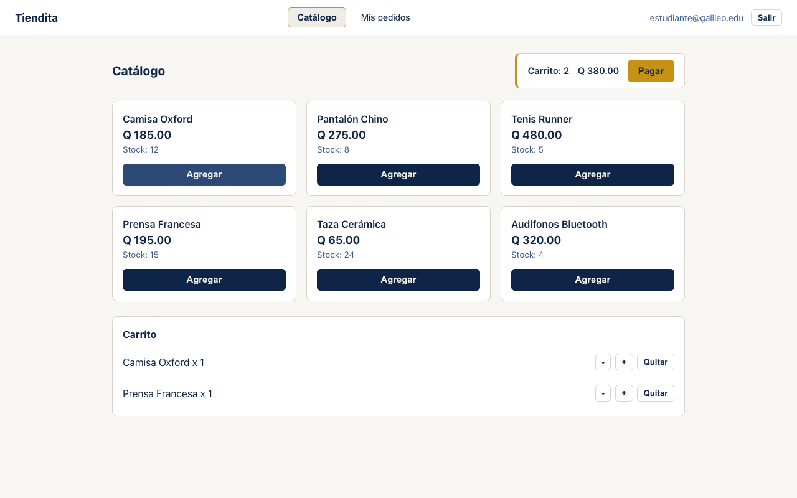
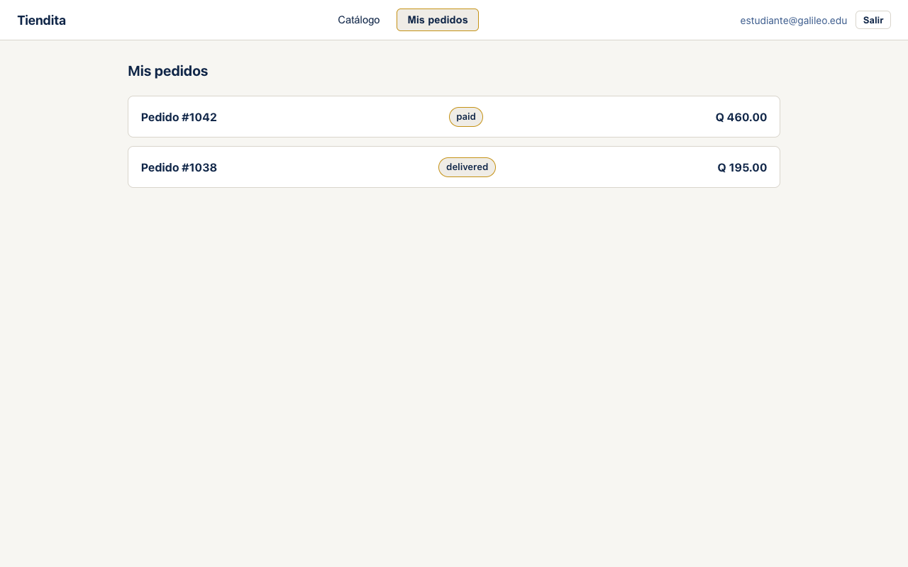

# Paso 5. React y TypeScript

Este paso toma unos 60 minutos, más unos 45 si haces el deploy opcional.

## Antes de empezar

1. ¿Qué ventajas da tipar las respuestas del backend en TypeScript antes de renderizarlas en una vista de React?
2. ¿Por qué conviene derivar totales como `totalCents` desde la lista de ítems del carrito en lugar de guardar un segundo estado manual?
3. Abre `frontend/src/__tests__/FreeShippingNotice.test.tsx`: ¿qué busca el test en la pantalla y por qué no revisa el código del componente?

## Por qué importa

En el posgrado construirás pantallas que hablan con un API y las probarás como las usa una persona. Si no distingues el estado del estado derivado, tus pantallas muestran totales que no cuadran con el carrito.

## Lo mínimo que necesitas saber

- **Componente.** Una función que recibe datos (props) y devuelve lo que se dibuja, escrito en JSX, una mezcla de HTML y TypeScript. `<FreeShippingNotice remainingCents={500} />` llama a esa función con esa prop.
- **UI declarativa.** No modificas la pantalla a mano. Describes cómo se ve para el estado actual y React vuelve a llamar tu componente cuando el estado cambia.
- **Estado y estado derivado.** `useState` guarda lo que cambia con el tiempo, como el carrito. Lo que se calcula a partir del estado, como el total o cuánto falta para el envío gratis, no se guarda aparte: se calcula en cada render.
- **Hook propio.** `useCart` es una función que agrupa estado y lógica del carrito para que varios componentes la usen. Por convención, su nombre empieza con `use`.
- **Hablar con el API.** `fetch` pide datos al backend y devuelve una promesa; `await` espera la respuesta. `frontend/src/lib/api.ts` agrega el token a cada request.

## Qué vas a hacer

- **Leer**. Revisa [example/python_vs_typescript.md](example/python_vs_typescript.md) si vienes de Python, y luego inspecciona `frontend/src/lib/api.ts`, `frontend/src/lib/auth.ts` y `frontend/src/views/CatalogView.tsx` para seguir cómo el navegador autentica sesiones y llama al backend.
- **Debuguear**. Levanta la base (`make db-up` y `make migrate`) y el API (`make dev-api`) en una terminal, y el frontend con `make dev-web` en otra. Sin el API, el catálogo sale vacío. En local entra con cualquier correo y contraseña: el API acepta esa sesión de prueba solo cuando lo levantas con `make dev-api`. Luego agrega tres unidades del mismo producto al carrito y compara el total con la cuenta a mano. Encuentra en `frontend/src/hooks/useCart.ts` por qué no coinciden.
- **Escribir**. Tiendita regala el envío desde `FREE_SHIPPING_CENTS` (Q 300.00). Completa `freeShippingRemainingCents` en `useCart.ts` y escribe el componente `frontend/src/views/FreeShippingNotice.tsx`, que avisa cuánto falta o que el envío ya es gratis. Después muéstralo en la barra del carrito de `CatalogView.tsx`, junto al total.
- **Reto opcional: deploy**. Conecta tu copia a Neon y [Neon Auth](https://neon.com/docs/guides/neon-auth), haz deploy del proyecto completo en [Vercel](https://vercel.com/docs/functions/runtimes/python) y registra tu URL pública en `app_url` dentro de `deploy.json`. Sigue [deploy.md](deploy.md). El badge del paso no depende de esto; hazlo cuando tengas tiempo para crear las tres cuentas.

## Referencia visual

Así se ven las tres vistas cuando la aplicación está lista.

## Criterios de aceptación

- `CA-5.1` `frontend/` pasa `npm run typecheck` y `npm run build` sin errores.
- `CA-5.2` `useCart` y las tres vistas principales pasan la suite de pruebas en `vitest`.
- `CA-5.3` `freeShippingRemainingCents` nunca es negativo y `FreeShippingNotice` anuncia con `role="status"` cuánto falta o que el envío es gratis, en el catálogo junto al total.
- Opcional: `deploy.json` apunta a tu URL de Vercel y `make check-prod` confirma `/api/health`, `/api/products`, `/api/orders/mine` y `/`.

## Al terminar

1. Si guardaras `totalCents` en un `useState` aparte, ¿qué pasaría al quitar un producto del carrito y olvidar actualizarlo?
2. `FreeShippingNotice` recibe `remainingCents` como prop en vez de leer el carrito. ¿Qué gana su test con eso?
3. Explica en tres líneas, con tus palabras, qué cambiaste y por qué. Si no puedes, vuelve a la pista 1 antes de seguir.

## Cómo verificar

Ejecuta `make check STEP=5` para validar el frontend y las pruebas en local, y corre `make check-prod` cuando tu app esté desplegada en Vercel. Revisa [example/python_vs_typescript.md](example/python_vs_typescript.md) o empieza por la [primera pista](hints/1.md).

## Respuestas de autoevaluación

### Antes de empezar

1. El compilador detecta al editar si escribiste mal el nombre de un campo (`price_cents` frente a `price`) o si olvidaste manejar un valor nulo antes de que falle en el navegador.
2. Si guardas dos estados para la misma verdad, cualquier cambio que actualice `items` y olvide actualizar `totalCents` deja la pantalla con montos inconsistentes.
3. Busca el elemento accesible con `role="status"` y el texto visible que lee la persona; así la prueba sigue pasando aunque cambies la estructura interna del componente.

### Al terminar

1. El total mostraría el monto viejo y el carrito quedaría inconsistente. Al calcularlo a partir de `items` en cada render, el total siempre corresponde a lo que hay en el carrito.
2. El test le pasa cualquier monto sin armar un carrito. El componente solo muestra; el cálculo vive en `useCart` y se prueba aparte.
3. Respuesta personal. Debe mencionar el total derivado de cantidad por precio y de dónde sale el monto que falta para el envío gratis.
